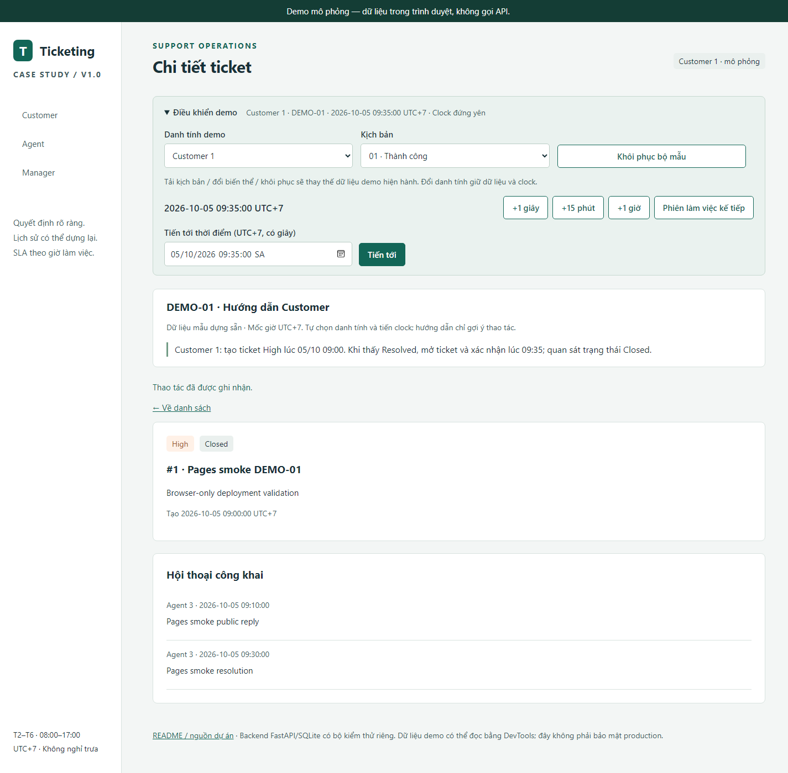

# BA Ticketing & SLA Case Study

Một case study Business Analyst cho doanh nghiệp phần mềm B2B **giả định**: yêu cầu hỗ trợ rời rạc, trách nhiệm chưa rõ và cách hiểu “đã giải quyết” chưa thống nhất. Giải pháp mẫu gồm quy trình, yêu cầu, prototype và backend mô phỏng; không dùng dữ liệu doanh nghiệp thật hoặc tuyên bố hiệu quả vận hành thực.

**Vai trò BA của chủ dự án:** xác định vấn đề/phạm vi, mô hình hóa quy trình, chốt business rules, stories/AC, thiết kế dữ liệu/API và phê duyệt kịch bản/kết quả. Codex hỗ trợ implementation, chạy công cụ và lưu bằng chứng. Việc chấp nhận kết quả không có nghĩa chủ dự án tự thao tác mọi test.

## Xem demo

### [Mở prototype trên GitHub Pages ↗](https://phuoctrong2005.github.io/ba-ticketing-sla-case-study/)

Mở **Điều khiển demo**, chọn Customer/Agent/Manager và một trong sáu nhóm, làm theo hướng dẫn, tiến clock UTC+7. **Khôi phục bộ mẫu** thay dữ liệu trình duyệt để thử lại. Không cần backend.



Ảnh từ lần public smoke mới nhất, dữ liệu mô phỏng DEMO-01; runtime khớp bản hiện hành. [Record và ảnh khác](tests/evidence/pages-public-smoke-20261013-002741.json).

## As-Is → To-Be

Email/tin nhắn và theo dõi thủ công → ticket có một Agent phụ trách, lịch sử sự kiện, hai SLA, Customer xác nhận kết quả và Manager review khi từ chối lặp lại. Đây là mô hình giả định, chưa khảo sát doanh nghiệp.

[As-Is](docs/02-process/as-is.md) · [To-Be](docs/02-process/to-be.md) · [Vòng đời ticket](docs/02-process/ticket-states.md) · [BPMN nguồn](docs/02-process/support-processes.drawio) — mở trang **As-Is** hoặc **To-Be**; ảnh xuất có trong hai tài liệu.

## Quyết định chính

| Chủ đề | Quy tắc đã chốt |
|---|---|
| SLA | T2–T6, 08:00–17:00, UTC+7; High: phản hồi 1 giờ/giải quyết 8 giờ làm việc; Normal: 2/16 giờ. Waiting tạm dừng giải quyết, từ chối không cấp lại ngân sách. |
| Phân quyền | Customer chỉ ticket của mình và nội dung công khai; Agent xử lý ticket được giao; Manager đọc dữ liệu nội bộ và ghi phương án. |
| Resolved / Closed | Agent báo Resolved với kết quả; Customer xác nhận mới Closed, hoặc từ chối để tiếp tục. Không tự đóng/mở lại Closed. |
| Tải | Chỉ nhận mới khi dưới 3 In Progress; Customer return có thể gây quá tải. |
| Review / dữ liệu | Từ lần từ chối 3 tạo review, chặn Resolved đến khi Manager hoàn tất; review không cấp thêm SLA. Projection dựng lại từ events; M-07 mô tả bối cảnh, không tự quy lỗi. |

Nguồn sự thật: [BR](docs/spec/business-rules.md), [codes](docs/spec/codes.md), [decision log](docs/decision-log.md); [open questions](docs/open-questions.md).

## Điều hướng portfolio

| Phần | Điểm bắt đầu |
|---|---|
| Tài liệu BA | [Project brief](docs/01-context/project-brief.md), [scope](docs/01-context/scope.md), [stakeholders](docs/01-context/stakeholders.md), [stories/AC](docs/03-requirements/user-stories-draft.md), [FR](docs/03-requirements/functional-requirements-draft.md), [NFR](docs/03-requirements/non-functional-requirements-draft.md) |
| Prototype | [Spec](docs/05-prototype/prototype-spec.md), [cách dùng](prototype/README.md) |
| Backend / API | [Thiết kế dữ liệu](docs/04-data-api/data-design.md), [contract](docs/04-data-api/api-contract.md), [OpenAPI](api/openapi.json), [hướng dẫn chạy](docs/backend-running.md) |
| SQL | [Truy vấn M-01…M-07 và giới hạn](sql/README.md) |
| Postman | [Import/chạy trên DB mới](api/README.md), [collection v2.1](api/ticketing-sla.postman_collection.json), [environment](api/ticketing-sla.postman_environment.json) |
| Evidence / nghiệm thu | [Chỉ mục bằng chứng](tests/evidence/README.md), [truy vết từng AC](docs/ac-traceability.md), [release checklist](docs/release-checklist.md), [TASKS](TASKS.md) |

## Chạy backend và test

Python 3.12; từ root repo, sau khi tạo `.venv` mới nếu chưa có:

```powershell
& .\.venv\Scripts\python.exe -m pip install -r requirements.txt
& .\.venv\Scripts\python.exe -m pytest
& .\.venv\Scripts\python.exe -m uvicorn backend.app:app --host 127.0.0.1 --port 8000
```

Mở `http://127.0.0.1:8000/docs`. Danh tính demo: Customer 1/2, Agent 3/4/5, Manager 6. [Chi tiết môi trường/SQLite/clean-start](docs/backend-running.md); [Newman với DB thử riêng](api/README.md).

## Kết quả đã đối chiếu

| Bộ kiểm tra | Kết quả nguồn | Đơn vị đếm / bằng chứng |
|---|---|---|
| Backend | **181 đạt, 0 lỗi** | 181 pytest case gồm parametrized fixtures; [Windows repo + clean-start JUnit](tests/evidence/step1-windows-20261012-162259-report.md). Hai race là test riêng trong suite. |
| Prototype local | **110 đạt, 0 lỗi** | 110 case JavaScript gồm 83 fixture và controller/DOM/UX; [run cuối](tests/evidence/prototype-ux-20261013-002503.json). |
| Pages public | **74/74 smoke check đạt** | 74 kiểm tra trên origin thật, sáu nhóm smoke ban đầu + DEMO-01 đến Closed; [record](tests/evidence/pages-public-smoke-20261013-002741.json). |
| Newman | **191 request, 514 assertion đạt, 0 lỗi** | Một run tuần tự, fresh DB, exit 0; [JSON/JUnit và run record](tests/evidence/postman-report-20261013.md). Assertion không phải tình huống độc lập. |

Đây là đối chiếu bằng chứng đã chạy, không phải lần chạy mới khi sửa README. Không cộng các số trên; fixture được dùng lại giữa các suite. [Traceability](docs/traceability.md) phân biệt chức năng, UI, SLA, đồng thời và tái lập.

## Giới hạn và phần còn thiếu

Danh tính demo không phải đăng nhập thật. Prototype lưu trong trình duyệt, **không gọi API**; dữ liệu đọc được qua DevTools. Pages smoke khác suite đầy đủ ở local; Newman tuần tự không chứng minh race hoặc biên lịch/deadline SLA. Các phần đó có bằng chứng pytest riêng. Chưa xác nhận cross-browser, thiết bị vật lý, hiệu năng hoặc uptime production.

**Video: Chưa có. Portfolio v1.0 chưa hoàn tất; chưa có tag v1.0.** [Checklist](docs/release-checklist.md) nêu bằng chứng và phần còn thiếu. Lịch sử dài/hashes: [evidence index](tests/evidence/README.md) và [README trước bản portfolio](https://github.com/PhuocTrong2005/ba-ticketing-sla-case-study/blob/41d0ebf5fc2c96b745fa65301f0f9ba7ece08221/README.md).

## Roadmap ngoài v1.0

Chuyển/tự phân công Agent; đổi ưu tiên, mở lại hoặc tự đóng ticket; CSAT; lịch ngày lễ; email/SMS; đa kênh/tenant; đăng nhập thật; nối prototype với API; xếp hạng Agent; thời hạn phản hồi công khai cho Customer. Các mục này chưa triển khai, cần chốt phạm vi trước khi làm.
