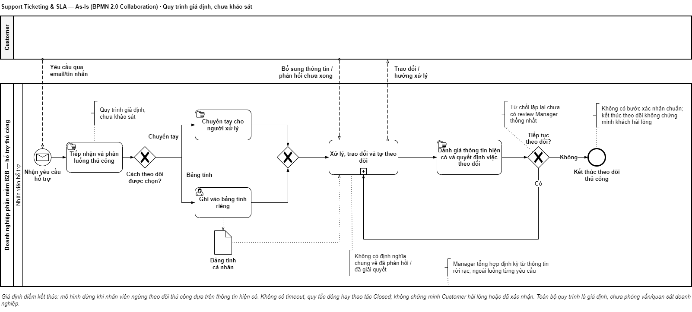
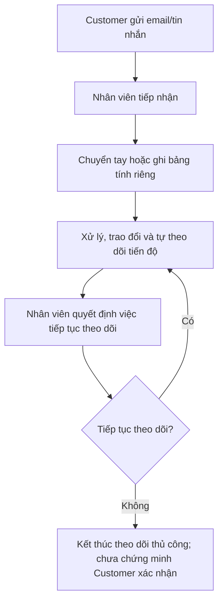

# Quy trình As-Is (giả định)

> As-Is là giả định của case study, chưa được xác nhận qua phỏng vấn hay quan sát doanh nghiệp.

Nguồn chỉnh sửa: [support-processes.drawio](support-processes.drawio), mở trang **As-Is**. Mermaid bên dưới là bản xem nhanh trên GitHub.

## 1. Các bước hiện tại (giả định)
1. Customer gửi yêu cầu qua email hoặc tin nhắn.
2. Nhân viên tiếp nhận, chuyển tay hoặc ghi vào bảng tính riêng.
3. Nhân viên tự theo dõi người xử lý, tiến độ và thời điểm phản hồi.
4. Nhân viên trao đổi, thông báo hướng xử lý hoặc báo đã giải quyết; cách hiểu về đã phản hồi/đã giải quyết chưa thống nhất.
5. Nếu khách chưa hài lòng, nhân viên tiếp tục trao đổi; không có bước review thống nhất khi bị từ chối lặp lại.
6. Manager tổng hợp tình hình từ thông tin rời rạc.

Nếu Customer báo chưa được giải quyết, nhân viên tiếp tục trao đổi. Điểm kết thúc ở đây là kết thúc theo dõi thủ công, không phải trạng thái Closed hoặc bằng chứng Customer hài lòng. Mô hình không giả định có bước xác nhận chuẩn cho mọi yêu cầu.

Manager tổng hợp tình hình định kỳ, thủ công, từ thông tin rời rạc; không phải mọi yêu cầu đều qua Manager trước khi kết thúc.

## 2. Bước, vấn đề giả định, mục tiêu To-Be
| Bước | Vấn đề giả định | Mục tiêu To-Be |
|---|---|---|
| 1-2 | Chuyển tay, không rõ người phụ trách | Một Agent nhận ticket, có lịch sử và kiểm tra đồng thời (G-01) |
| 2-3 | Không biết ưu tiên việc nào | Hàng đợi gợi ý thứ tự (G-02) |
| 3-4 | Không có quy tắc đo thời gian | Hai đồng hồ SLA theo lịch làm việc (G-03) |
| 4-5 | "Đã giải quyết" nhưng khách chưa đồng ý | Bước khách xác nhận hoặc từ chối (G-05) |
| 5 | Từ chối lặp lại chỉ nhân viên biết | Review của Manager từ lần từ chối thứ ba (G-08) |
| 6 | Báo cáo rời rạc, dễ quy lỗi cho nhân viên | Báo cáo có tử số, mẫu số và bối cảnh (G-06) |

Tài liệu không nêu tỷ lệ bỏ sót, thời gian tiết kiệm hay mức cải thiện vì chưa có dữ liệu thực.
