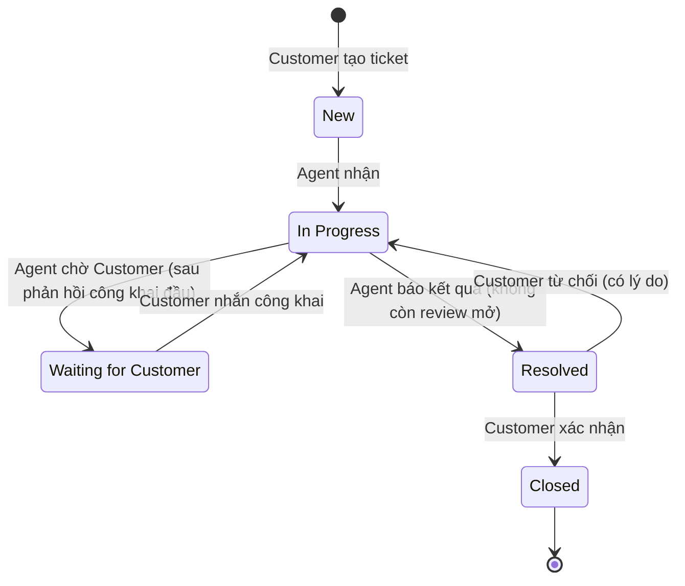

# Vòng đời ticket (năm trạng thái)

Review của Manager là luồng đi kèm, không phải trạng thái thứ sáu (D-26).

| Từ | Sang | Ai kích hoạt | Điều kiện | Ảnh hưởng SLA | BR |
|---|---|---|---|---|---|
| New | In Progress | Agent | Ticket chưa có người nhận; Agent có dưới 3 ticket In Progress | Hai đồng hồ đã bắt đầu tính từ lúc tạo, chỉ cộng giây làm việc; lưu snapshot lúc nhận | BR-08, BR-13, BR-15, BR-16, BR-17, BR-37 |
| In Progress | Waiting for Customer | Agent phụ trách | Trước đó đã từng có phản hồi công khai của Agent; vẫn hợp lệ khi review đang mở | Đồng hồ giải quyết tạm dừng | BR-08, BR-20, BR-57 |
| Waiting for Customer | In Progress | Customer | Customer gửi tin nhắn công khai; hệ thống tự chuyển | Giải quyết tiếp tục với ngân sách còn lại, không reset; giữ vi phạm đã xảy ra | BR-08, BR-10, BR-20, BR-23, BR-48 |
| In Progress | Resolved | Agent phụ trách | Có nội dung kết quả công khai; không còn review mở (nếu còn: 409 `REVIEW_REQUIRED`, BR-53) | Giải quyết dừng; hoàn tất phản hồi đầu nếu đây là phản hồi công khai đầu tiên | BR-08, BR-11, BR-20, BR-53 |
| Resolved | Closed | Customer | Customer xác nhận | Kết quả giải quyết thành cuối cùng | BR-08, BR-23 |
| Resolved | In Progress | Customer | Customer từ chối, bắt buộc có lý do. Từ lần từ chối thứ ba, ghi nhận từ chối, chuyển trạng thái và tạo review nằm trong cùng một giao dịch | Đồng hồ giải quyết tiếp tục với ngân sách còn lại; tính deadline mới theo BR-23. Từ chối ngoài giờ theo BR-38; còn 0 giây trong giờ theo BR-46. Giữ vi phạm đã xảy ra; không nhân đôi, không reset | BR-08, BR-21, BR-23, BR-38, BR-46, BR-52 |

## Ghi chú
- Closed là trạng thái cuối: không nhắn, ghi chú, xác nhận/từ chối tiếp hoặc mở lại; quyền xem vẫn theo vai trò (BR-03, BR-05, BR-34). Các thao tác bị từ chối quy định tại BR-44, BR-50, BR-51.
- Resolved không tự đóng (BR-09). Ở Resolved, Customer chỉ xác nhận hoặc từ chối (BR-10).
- Không có chuyển trực tiếp New → Resolved.
- Customer nhắn ở New hoặc In Progress không đổi trạng thái. Agent nhắn hoặc ghi chú ở Waiting không làm đồng hồ giải quyết chạy lại (BR-10).
- Thao tác ngoài giờ vẫn được ghi nhận; SLA chỉ cộng giây làm việc (BR-59).
- Review tự nó không tạm dừng SLA (BR-56). Nếu ticket chuyển Waiting hợp lệ trong lúc review mở, đồng hồ giải quyết tạm dừng do trạng thái Waiting (BR-20, BR-57).
