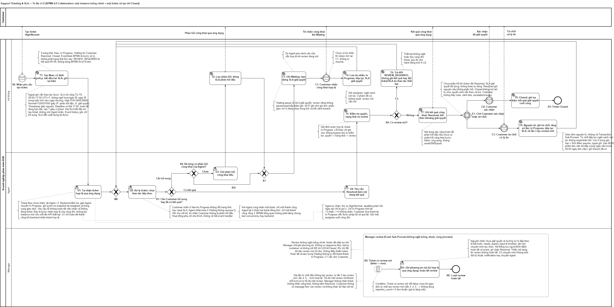
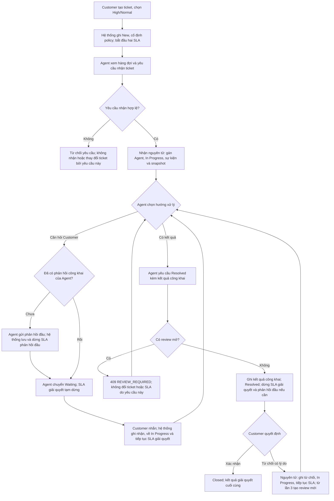
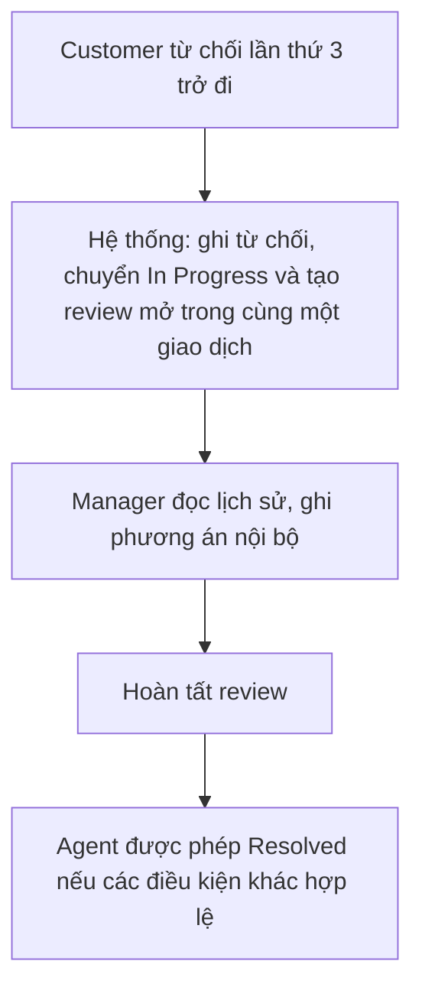

# Quy trình To-Be v1.0

Mô tả giải pháp ở mức nghiệp vụ. Quy tắc chi tiết nằm ở [business-rules.md](../spec/business-rules.md); bảng chuyển trạng thái ở [ticket-states.md](ticket-states.md).

Nguồn chỉnh sửa: [support-processes.drawio](support-processes.drawio), mở trang **To-Be**.

## 1. Luồng chính của ticket

Ghi chú:
- Đây là flowchart nghiệp vụ để đọc nhanh, không phải BPMN 2.0. Nhánh từ chối nhận kết thúc yêu cầu nhận không thành công, không đóng ticket. Muốn thử lại phải có yêu cầu người dùng mới; không tự lặp khi điều kiện chưa đổi.
- Customer không phản hồi ở Resolved thì ticket giữ Resolved, không tự đóng (BR-09).
- Agent không bắt buộc gửi phản hồi mới mỗi lần chuyển Waiting; điều kiện là đã từng có phản hồi công khai đầu (BR-08).
- Agent có thể ghi chú nội bộ hoặc nhắn công khai ở In Progress và Waiting; các thao tác này không đổi trạng thái (BR-10).
- Sơ đồ BPMN chỉnh sửa được nằm trong [support-processes.drawio](support-processes.drawio), mở trang **To-Be**. Mermaid ở trên là bản xem nhanh trên GitHub.

## 2. Luồng review của Manager (chạy song song)

1. Từ lần từ chối thứ ba trở đi, mỗi lần từ chối tạo một lượt review mở (BR-52).
2. Manager ghi phương án nội bộ bất cứ lúc nào khi review đang mở, kể cả khi ticket ở In Progress hoặc Waiting. Agent không cần thử Resolved để kích hoạt bước này (BR-54, BR-55, BR-57).
3. Khi Agent yêu cầu Resolved, hệ thống kiểm tra review: còn mở thì trả `409 REVIEW_REQUIRED`; đã hoàn tất thì tiếp tục (BR-53).
4. Review mở vẫn cho phép Agent chuyển Waiting. Manager hoàn tất review khi ticket đang Waiting không đổi trạng thái ticket; chỉ Customer nhắn công khai mới đưa ticket về In Progress (BR-08, BR-57).
5. Manager không nhắn công khai, không nhận ticket, không bấm Resolved (BR-05).
6. Chờ Manager review không tự tạm dừng SLA; M-07 chỉ ghi bối cảnh thời gian chờ (BR-56).
7. Nếu ticket đang Waiting, đồng hồ giải quyết tạm dừng do Waiting, không phải do review (BR-20, BR-56, BR-57).
8. Khi đang có review mở, Agent tiếp tục xử lý nhưng không tự gỡ review; Manager phải ghi phương án hợp lệ trước khi Agent có thể Resolved. Từ chối lần thứ nhất hoặc thứ hai không tạo review và không bắt buộc Manager ghi phương án (BR-52, BR-53).

## 3. Tác động đến SLA theo bước
| Bước | Phản hồi đầu | Giải quyết |
|---|---|---|
| Tạo ticket | Bắt đầu tính, chỉ cộng giây làm việc | Bắt đầu tính, không chờ Agent nhận |
| Agent nhận | Lưu snapshot; đồng hồ tiếp tục chạy | Lưu snapshot; đồng hồ tiếp tục chạy |
| Phản hồi công khai đầu | Dừng, đo một lần | Tiếp tục chạy khi ticket ở In Progress |
| Waiting | Đã hoàn tất trước khi vào Waiting; không đổi | Tạm dừng |
| Customer nhắn khi Waiting | Không đổi | Tiếp tục với ngân sách còn lại; giữ vi phạm đã có |
| Resolved | Hoàn tất nếu đây là phản hồi công khai đầu | Dừng |
| Customer từ chối | Không đổi | Tiếp tục với ngân sách còn lại, không reset, không nhân đôi |
| Closed | Không đổi | Kết quả thành cuối cùng |

Snapshot tính tại `as_of = assigned_at`, chỉ ghi pending hoặc breached, không bắt đầu lại đồng hồ. Mọi khoảng chạy chỉ cộng giây làm việc. Customer nhắn ở New/In Progress không đổi trạng thái hoặc reset SLA. Tin nhắn Customer và ghi chú nội bộ không phải phản hồi đầu của Agent.

## 4. Ngoại lệ dễ sai
| Tình huống | Hành vi | BR |
|---|---|---|
| Agent có từ 3 ticket In Progress trở lên | Không nhận ticket New; ticket Customer đưa trở lại In Progress vẫn được phép | BR-13, BR-14 |
| Hai Agent nhận cùng ticket; hoặc một Agent tải 2 nhận hai ticket | Chỉ một thao tác thành công | BR-15, BR-37 |
| Review đang mở, Agent thử Resolved | 409 `REVIEW_REQUIRED`; chuyển Waiting vẫn hợp lệ | BR-53, BR-57 |
| Customer không phản hồi ở Resolved | Giữ Resolved, không tự đóng | BR-09 |
| Các thao tác làm thay đổi ticket trên Closed | Bị từ chối; không mở lại; quyền xem vẫn theo vai trò | BR-03, BR-05, BR-34, BR-44, BR-50, BR-51 |
| Thao tác ngoài giờ | Vẫn được ghi nhận; SLA chỉ cộng giây làm việc; không phải bước chặn | BR-59 |
| Quyền | Kiểm tra ở backend; Customer không thấy ghi chú, cảnh báo, review nội bộ | BR-06, BR-49 |

Mã HTTP cụ thể tra ở BR-32 đến BR-34, BR-37, BR-43 đến BR-45, BR-50, BR-51, BR-58.

## 5. Ngoài phạm vi To-Be v1.0
Theo [scope v1.0](../01-context/scope.md), gồm email/SMS thật, tự phân công, chuyển Agent, tự đóng, mở lại Closed; không thêm vai trò hay trạng thái. Cờ cần chuyên môn chỉ là thông tin nội bộ, không tạo thông báo hay phân công kỹ thuật.
