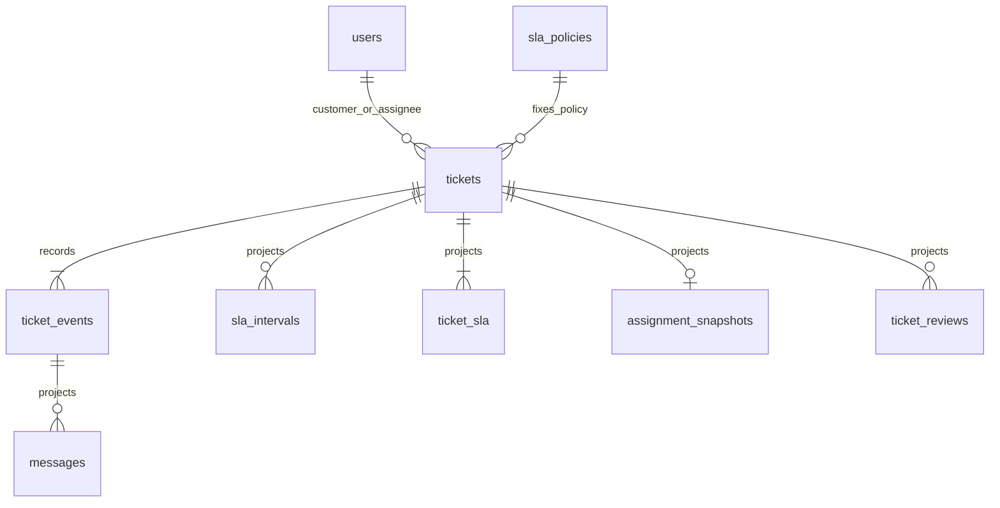

# ERD và data dictionary — approved 12/10/2026

Chủ dự án đã duyệt hướng thiết kế trong báo cáo rà soát. Tài liệu này cụ thể hóa chín bảng BR-31; không mở rộng phạm vi. Schema thực thi: [schema.sql](../../backend/schema.sql).

| Bảng | Dữ liệu | Ràng buộc |
|---|---|---|
| users | id INTEGER PK, display_name TEXT, role TEXT | role CUSTOMER/AGENT/MANAGER; danh tính demo |
| sla_policies | id TEXT PK, first_response_seconds INTEGER, resolution_seconds INTEGER | HIGH 3600/28800; NORMAL 7200/57600; không sửa policy đã dùng |
| tickets | id INTEGER PK, customer_id FK, priority/policy_id TEXT, title/description TEXT, created_at TEXT, status TEXT, assignee_id FK nullable, assigned_at/closed_at nullable, rejection_count INTEGER | Projection; giữ ưu tiên và policy lúc tạo |
| ticket_events | event_id INTEGER PK AUTOINCREMENT, ticket_id FK, actor_id FK nullable, occurred_at/occurred_at_raw TEXT, event_type TEXT, state_before/after TEXT, policy_id FK, payload JSON TEXT | Chỉ bổ sung; actor null dành tác động hệ thống; DB cấp thứ tự |
| messages | source_event_id PK/FK, ticket_id FK, actor_id FK, created_at TEXT, visibility TEXT, content TEXT | Projection; không sửa nội dung độc lập |
| sla_intervals | ticket_id FK, clock_type TEXT, ordinal INTEGER, started_at TEXT, ended_at TEXT nullable, business_seconds INTEGER nullable, start_event_id FK, end_event_id FK nullable | PK ticket/clock/ordinal; mở không lưu giây; giữ khoảng 0 |
| ticket_sla | ticket_id FK, clock_type TEXT, closed_consumed_seconds INTEGER, applicable_deadline TEXT nullable, state_at_event TEXT, remaining_at_event_seconds INTEGER | PK ticket/clock; snapshot tại event, không phải bộ đếm sống |
| assignment_snapshots | ticket_id PK/FK, assignment_event_id FK, assigned_at TEXT, first_response_sla_status_at_assignment TEXT, resolution_sla_status_at_assignment TEXT | Mỗi ticket một lần nhận; pending/breached |
| ticket_reviews | ticket_id FK, review_key TEXT, resolution_cycle_id INTEGER FK event, requested_event_id FK, completed_event_id FK nullable, review_requested_at TEXT, review_completed_at TEXT nullable, reviewed_by FK nullable, handling_plan JSON TEXT nullable | PK ticket/key; unique review mở/ticket; chu kỳ dùng event bắt đầu từ chối |

Timestamp persist và API giữ ISO8601 +07:00, cắt phần dưới giây; raw giữ riêng (BR-25). Duration INTEGER seconds. JSON source payload dùng nội dung nghiệp vụ; mọi bảng còn lại chiếu lại từ event/policy. Mỗi event resolved lưu resolution_snapshot (remaining_seconds, consumed_seconds, due_at, status) như dữ liệu dẫn xuất bất biến để truy vấn từng lượt; engine không dùng snapshot này làm đáp án. ticket_sla chỉ là snapshot hiện tại. Test dựng lại so từng snapshot với prefix sự kiện đến đúng event_id; không dùng event cùng giây xảy ra sau nó. Kiểm thử dựng lại so sánh toàn bộ projection. Dữ liệu quá khứ dùng replay chỉ đến as_of.

Event hợp lệ: ticket_created, agent_assigned, agent_public_reply, customer_public_message, internal_note, status_waiting, resolved, customer_reject, customer_confirm, review_completed. Tác động tự động (resume, review) nằm trong cùng event Customer gây ra, state_after ghi kết quả; không giả tạo sự kiện thao tác thất bại.
